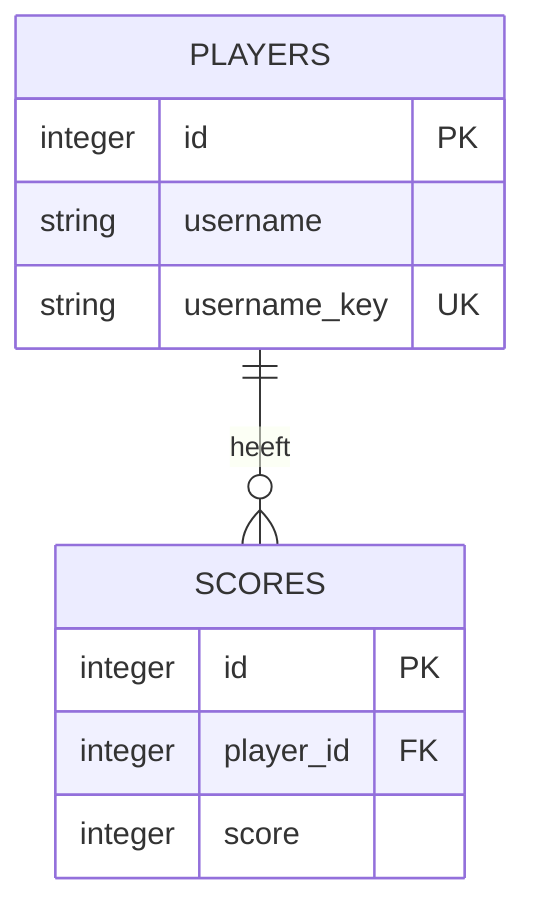

# Ontwerp voor sprint 3 en 4

Gebaseerd op [het Trello-bord](https://trello.com/b/IEi2Nb14/sppr-fd-sd24).
De bestaande consoleapp en GET-responses (id, username, score) blijven bruikbaar.

## API

| Methode | Pad | Betekenis |
|---|---|---|
| GET | / | Test of de server draait |
| GET, POST | /players | Spelers lezen / toevoegen |
| GET, PUT, PATCH, DELETE | /players/{player_id} | Speler lezen / vervangen / deels wijzigen / verwijderen |
| GET | /leaderboard | Spelers op actuele score aflopend, bij gelijkstand op id |
| GET, POST | /players/{player_id}/scores | Scoregeschiedenis lezen / score toevoegen |
| GET | /scores | Alle scores lezen |
| GET, PATCH, DELETE | /scores/{score_id} | Score lezen / corrigeren / verwijderen |

POST geeft 201, DELETE 204 zonder body, lezen en wijzigen 200.
Een onbekend id geeft 404; verkeerde invoer 422; een dubbele username 409.
Een lege PATCH geeft 400. PUT vervangt username en actuele score volledig.
PATCH wijzigt uitsluitend meegegeven velden. Namen worden getrimd en mogen
1–50 tekens lang zijn. Unieke namen worden zonder hoofdletterverschil vergeleken.
Scores zijn gehele getallen tussen 0 en 2.147.483.647.

## Database

SQLite via SQLAlchemy, met een bestand naast de broncode: players.db.
Een alternatieve database kan via PLAYER_DATABASE worden ingesteld.

Een Player kan meerdere Scores hebben. De **laatst toegevoegde score** (hoogste
score-id) is de actuele score; zonder score is die 0. Daarmee blijft 'score
aanpassen' uit sprint 1 werken, ook bij een verlaging. Het leaderboard gebruikt
de actuele score. Een nieuwe score bewaart de geschiedenis; PATCH op een
score corrigeert die registratie. Na verwijderen van de laatste score wordt de
voorgaande score actueel. Verwijderen van een speler verwijdert diens scores.

Primary keys identificeren records; scores.player_id verwijst als foreign key
naar players.id. Foreign keys zijn ingeschakeld op elke SQLite-verbinding.
De database bewaakt unieke namen en geldige scores ook buiten de API.

Bij de eerste start wordt players.json in één transactie geïmporteerd, met
behoud van ids en scores. Een metadata-record onthoudt dat de import klaar is;
verwijderde spelers komen dus niet bij elke herstart terug. Een ongeldig bestand
geeft een duidelijke fout, zonder gedeeltelijke import of aanpassing van JSON.
Na de import gebruiken console en API dezelfde database.

## Verificatie

Test CRUD, scorekoppelingen, validatie, sortering, 404/409/422/400/204,
eenmalige import, databasebeperkingen en herstart met een tijdelijk databasebestand.
Controleer ook Swagger en de console zonder echte spelersdata te veranderen.

## Projectstructuur (sprint 5)

Voor de refactor stonden alle endpoints en de databasesessie in `api.py`.
De businesslogica (`service.py`), opslag (`database.py`, `models.py`) en
invoercontrole (`schemas.py`) waren al gescheiden. Daarom verplaatsen we alleen
de HTTP-routes en gedeelde dependencies; een extra laag voor elke functie is niet nodig.

- `api.py` maakt de applicatie, opent/sluit de database en koppelt de routers.
- `routers/players.py` bevat de HTTP-acties voor spelers.
- `routers/scores.py` bevat de HTTP-acties voor scores en scoregeschiedenis.
- `routers/leaderboard.py` bevat het leaderboard-endpoint.
- `dependencies.py` levert per request een databasesessie en valideert ids.
- `service.py` voert CRUD en scoreberekeningen uit, ook voor het consolemenu.
- `models.py` beschrijft tabellen, sleutels en relaties in SQLAlchemy.
- `schemas.py` controleert requestgegevens en bepaalt de publieke responsevelden.

Een router verwerkt HTTP, een service voert de actie uit en een model beschrijft
de opslag. Dit is Separation of Concerns. Een Pydantic-schema is dus geen
databasetabel. De routes importeren de gedeelde onderdelen, zonder dat de service
van FastAPI afhankelijk wordt. Bestaande URL's en responses blijven hetzelfde.

Nog zelf te doen: laat een klasgenoot de indeling bekijken, vraag of duidelijk
is waar een nieuwe route thuishoort en geef ook feedback op diens API.
Noteer de naam, datum en echte feedback; deze uitwisseling is nog niet uitgevoerd.
