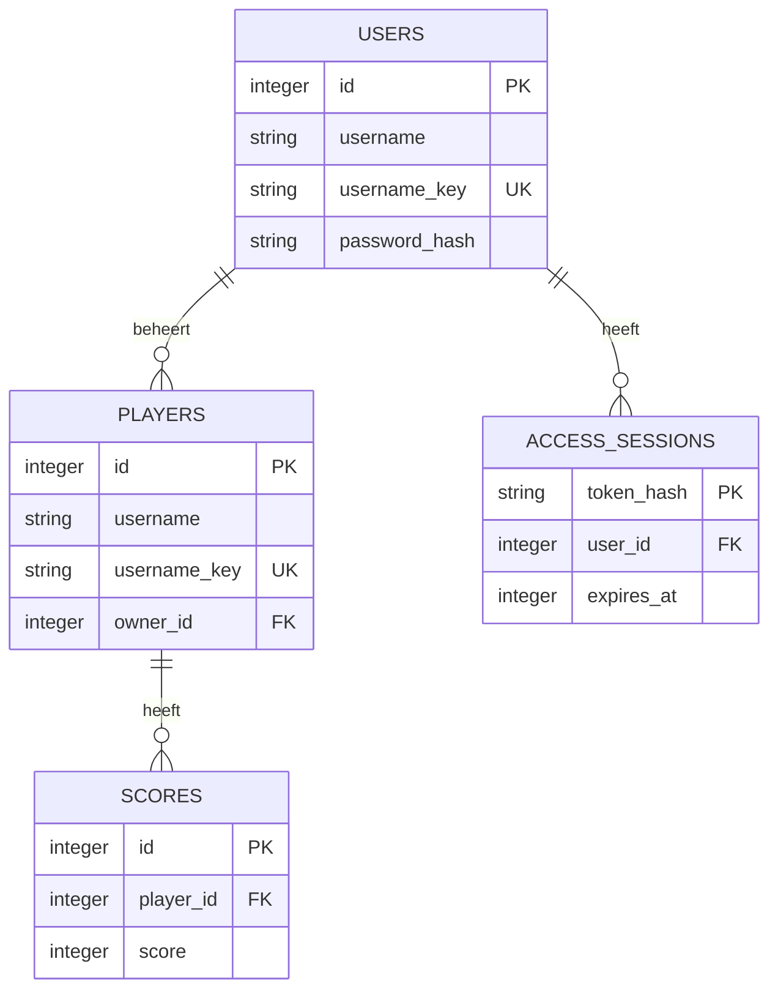

# Projectstructuur en database

Gebaseerd op [het Trello-bord](https://trello.com/b/IEi2Nb14/sppr-fd-sd24).
De bestaande consoleapp en GET-responses (id, username, score) blijven bruikbaar.

## API

| Methode | Pad | Betekenis |
|---|---|---|
| GET | / | Test of de server draait |
| GET, POST | /players | Spelers lezen / toevoegen |
| GET, PUT, PATCH, DELETE | /players/{player_id} | Speler lezen / vervangen / deels wijzigen / verwijderen |
| GET | /leaderboard | Spelers op actuele score aflopend, bij gelijkstand op id |
| GET, POST | /players/{player_id}/scores | Scoregeschiedenis lezen / score toevoegen |
| GET | /scores | Alle scores lezen |
| GET, PATCH, DELETE | /scores/{score_id} | Score lezen / corrigeren / verwijderen |

POST geeft 201, DELETE 204 zonder body, lezen en wijzigen 200.
Een onbekend id geeft 404; verkeerde invoer 422; een dubbele username 409.
Een lege PATCH geeft 400. PUT vervangt username en actuele score volledig.
PATCH wijzigt uitsluitend meegegeven velden. Namen worden getrimd en mogen
1–50 tekens lang zijn. Unieke namen worden zonder hoofdletterverschil vergeleken.
Scores zijn gehele getallen tussen 0 en 2.147.483.647.

## Database

SQLite via SQLAlchemy, met een bestand naast de broncode: players.db.
Een alternatieve database kan via PLAYER_DATABASE worden ingesteld.

Een Player kan meerdere Scores hebben. De **laatst toegevoegde score** (hoogste
score-id) is de actuele score; zonder score is die 0. Daarmee blijft 'score
aanpassen' uit sprint 1 werken, ook bij een verlaging. Het leaderboard gebruikt
de actuele score. Een nieuwe score bewaart de geschiedenis; PATCH op een
score corrigeert die registratie. Na verwijderen van de laatste score wordt de
voorgaande score actueel. Verwijderen van een speler verwijdert diens scores.

Primary keys identificeren records; scores.player_id verwijst als foreign key
naar players.id. Foreign keys zijn ingeschakeld op elke SQLite-verbinding.
De database bewaakt unieke namen en geldige scores ook buiten de API.

Bij de eerste start wordt players.json in één transactie geïmporteerd, met
behoud van ids en scores. Een metadata-record onthoudt dat de import klaar is;
verwijderde spelers komen dus niet bij elke herstart terug. Een ongeldig bestand
geeft een duidelijke fout, zonder gedeeltelijke import of aanpassing van JSON.
Na de import gebruiken console en API dezelfde database.

## Verificatie

Test CRUD, scorekoppelingen, validatie, sortering, 404/409/422/400/204,
eenmalige import, databasebeperkingen en herstart met een tijdelijk databasebestand.
Controleer ook Swagger en de console zonder echte spelersdata te veranderen.

## Projectstructuur (sprint 5)

Voor de refactor stonden alle endpoints en de databasesessie in `api.py`.
De businesslogica (`service.py`), opslag (`database.py`, `models.py`) en
invoercontrole (`schemas.py`) waren al gescheiden. Daarom verplaatsen we alleen
de HTTP-routes en gedeelde dependencies; een extra laag voor elke functie is niet nodig.

- `api.py` maakt de applicatie, opent/sluit de database en koppelt de routers.
- `routers/players.py` bevat de HTTP-acties voor spelers.
- `routers/scores.py` bevat de HTTP-acties voor scores en scoregeschiedenis.
- `routers/leaderboard.py` bevat het leaderboard-endpoint.
- `dependencies.py` levert per request een databasesessie en valideert ids.
- `service.py` voert CRUD en scoreberekeningen uit, ook voor het consolemenu.
- `models.py` beschrijft tabellen, sleutels en relaties in SQLAlchemy.
- `schemas.py` controleert requestgegevens en bepaalt de publieke responsevelden.

Een router verwerkt HTTP, een service voert de actie uit en een model beschrijft
de opslag. Dit is Separation of Concerns. Een Pydantic-schema is dus geen
databasetabel. De routes importeren de gedeelde onderdelen, zonder dat de service
van FastAPI afhankelijk wordt. Bestaande URL's en responses blijven hetzelfde.

Nog zelf te doen: laat een klasgenoot de indeling bekijken, vraag of duidelijk
is waar een nieuwe route thuishoort en geef ook feedback op diens API.
Noteer de naam, datum en echte feedback; deze uitwisseling is nog niet uitgevoerd.

## Accounts en rechten (sprint 6)

Authentication beantwoordt: wie doet dit verzoek? Authorization beantwoordt:
mag deze gebruiker deze actie uitvoeren? Een geldig token is dus niet genoeg
om de speler van iemand anders te mogen verwijderen.

`routers/auth.py` handelt HTTP af. `auth_service.py` registreert accounts en
beheert sessies. `security.py` bevat de hash- en tokenfuncties. De dependency
`CurrentUser` bepaalt wie is ingelogd. De spelers- en scoreroutes controleren
daarna het eigenaarschap via de service, voordat ze de wijziging uitvoeren.

### Gekozen beveiliging

- Wachtwoorden worden met Argon2id via `pwdlib` gehasht, met een willekeurige salt.
  Alleen `password_hash` wordt opgeslagen. Hashes worden niet teruggestuurd.
- Een login maakt een willekeurig token met 32 bytes toeval (256 bits).
  Alleen de SHA-256-hash van dit token staat in `access_sessions`.
- Dit is een server-side sessie met een opaque Bearer-token, geen JWT. Voor één
  lokale API is dit eenvoudig te begrijpen en logout kan het token direct intrekken.
- `expires_at` begrenst de geldigheid tot één uur. De hash, vervaltijd en het
  bestaan van het account worden bij ieder beveiligd verzoek gecontroleerd.
- OAuth2PasswordBearer en een formulier-login laten de Authorize-knop in Swagger
  werken. Er is geen OAuth-provider of externe accountdienst nodig.
- Invoerfouten bevatten geen teruggekaatste invoer, zodat een fout wachtwoord
  ook niet in de JSON-foutmelding verschijnt. Tokenresponses zijn niet cachebaar.

### Rechten

| Actie | Toegang |
|---|---|
| GET spelers, scores en leaderboard | Iedereen; dit zijn openbare scoregegevens |
| Registreren en inloggen | Iedereen |
| GET /auth/me, POST /auth/logout | Geldige ingelogde gebruiker |
| POST /players | Ingelogd; owner_id komt van het token |
| PUT/PATCH/DELETE speler | Alleen de eigenaar |
| POST score bij speler | Alleen de eigenaar van die speler |
| PATCH/DELETE score | Alleen de eigenaar van de gekoppelde speler |

Geen/ongeldig/verlopen token geeft 401 met `WWW-Authenticate: Bearer`.
Een ingelogde niet-eigenaar krijgt 403. Een ontbrekend record geeft 404.
De client kan `owner_id` niet meesturen of veranderen; extra velden worden geweigerd.
Scorecontrole gaat ook via de bijbehorende speler, zodat een los score-id geen
manier is om de rechten te omzeilen.

### Bestaande gegevens en lokaal beheer

De upgrade maakt `users` en `access_sessions` aan en voegt een nullable `owner_id`
toe aan bestaande spelers. De ids, namen en scores worden behouden. De migratie
kan bij elke start veilig opnieuw gecontroleerd worden.

Oude spelers hebben geen eigenaar. De eerste registrant krijgt daar geen rechten
op. Alleen iemand met lokale toegang kan met `assign_owner.py` een eigenaar koppelen.
Het consolemenu blijft lokaal beheer en gebruikt rechtstreeks de service. Deze
lokale toegang is dus vertrouwd, zoals het rechtstreeks openen van SQLite.

De app start standaard alleen op 127.0.0.1. Het project is een lokale onderwijsdemo;
publieke hosting vraagt daarnaast onder andere HTTPS en bescherming tegen veel
loginpogingen. Dat is niet in deze twee sprintopdrachten uitgewerkt.

Bronnen: [FastAPI-projectstructuur](https://fastapi.tiangolo.com/tutorial/bigger-applications/),
[FastAPI-wachtwoordhashes en Bearer-authenticatie](https://fastapi.tiangolo.com/tutorial/security/oauth2-jwt/).

## Betrouwbaarheid en API-contract (sprint 7 en 8)

`errors.py` handelt verwachte domeinfouten, invoerfouten en interne fouten op één
plek af. De bestaande detail-string voor 400/401/403/404/409 blijft herkenbaar.
Validatiefouten hebben een lijst met loc, msg en type, zonder teruggestuurde invoer.
Een operationele databasefout geeft 503; andere interne fouten geven generieke JSON
met 500. Het sluiten van de request-sessie draait niet-gecommitte werk terug.

De nieuwe regressietests beschermen drie concrete reparaties: besturingstekens
in namen, ongeldige Unicode in wachtwoorden en dubbele scorehistorie door een
herhaalde PUT. Expliciet een score toevoegen met POST blijft een nieuwe registratie.

`responses.py` koppelt foutmodellen, voorbeelden en headers aan de OpenAPI-documentatie.
De routes documenteren alleen de loginplicht die ze daadwerkelijk hebben. Schemas
bevatten bruikbare voorbeelden. `export_openapi.py` exporteert het contract zonder
de database te openen; de contracttests bewaken de export én echte API-antwoorden.

De README is de ingang. `docs/GEBRUIKEN.md` beschrijft de oefening voor een nieuwe
gebruiker. `API_CONTRACT.md` beschrijft de afspraken voor een ontwikkelaar.
`docs/KLASGENOOT.md` legt de nog uit te voeren onafhankelijke controle vast.
